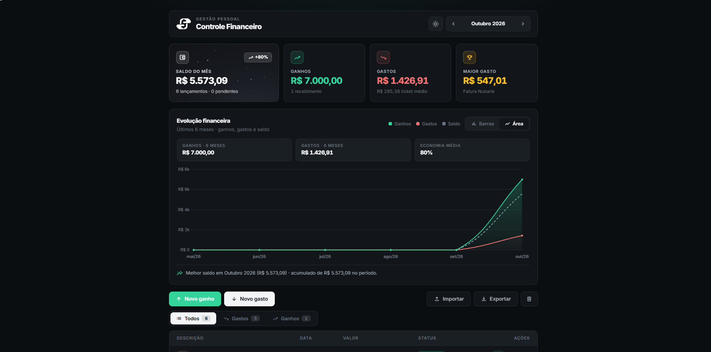
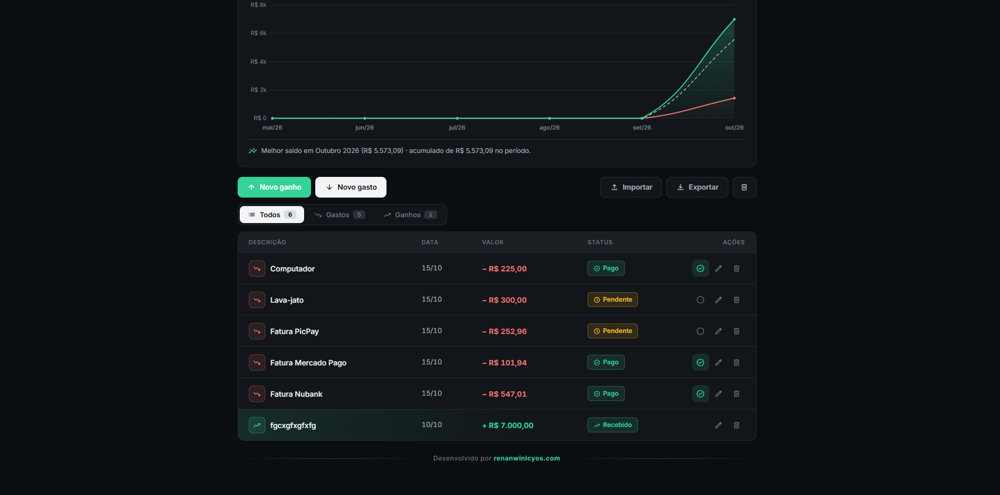
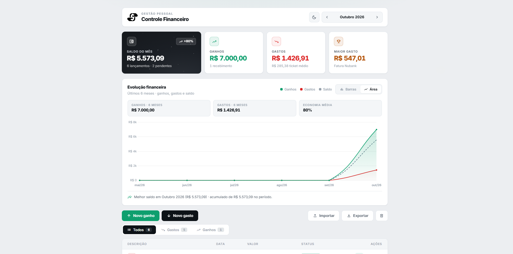
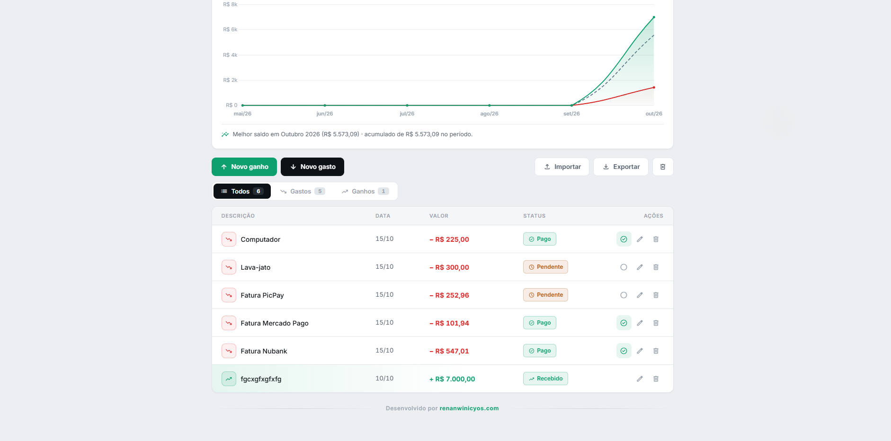
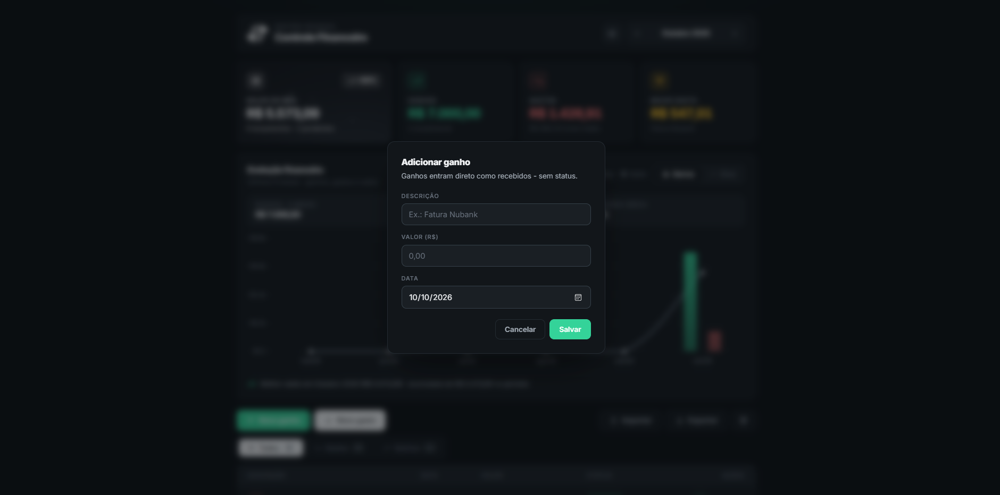
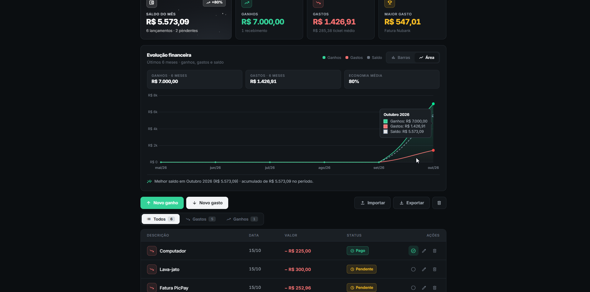

<h1> Controle Financeiro</h1>

Fiz esse sistema pra controlar meu dinheiro de um jeito simples e resolvi deixar aberto pra quem quiser usar também.

Não precisa instalar nada, nem criar conta, nem nada disso. É só baixar e usar.

## Prints

<p align="center">
  
  
  
</p>

<p align="center">
  
  
  
</p>

## Como usar, passo a passo

1. Primeiro baixa o projeto aqui do github (pode baixar o zip ou só os arquivos)
2. Depois é só abrir o `index.html` no navegador com dois cliques
3. Pronto, aí é só lançar os ganhos e gastos do mês
4. Os dados ficam salvos no próprio navegador, não sai da sua máquina

Se quiser levar pra outro pc é só clicar em Exportar e guardar o `.json`. Pra trazer de volta é só clicar em Importar e escolher o arquivo.

## O que ele faz hoje

- Lança ganho e gasto por mês
- Marca gasto como pago ou pendente
- Mostra saldo, total de ganhos, total de gastos, maior gasto e ticket médio
- Gráfico dos últimos 6 meses em barra ou área
- Tem modo claro e escuro
- Botão de exportar e importar backup em json
- Botão de apagar todos os dados

Simples assim, site normal sem build e sem frescura. Pra rodar local é só abrir o index.html.

## Formato do json pra importar

O botão Importar aceita o mesmo arquivo que o Exportar gera: um objeto onde a chave é o mês (`AAAA-MM`) e o valor é a lista de lançamentos.

```json
{
  "2026-10": [
    {
      "description": "Salário",
      "value": 3500,
      "type": "income",
      "paid": true,
      "date": "2026-10-05"
    },
    {
      "description": "Fatura Nubank",
      "value": 890.5,
      "type": "expense",
      "paid": false,
      "date": "2026-10-10"
    }
  ]
}
```

Regras: `description` é o nome, `value` é o valor, `type` é `income` (ganho) ou `expense` (gasto), `paid` diz se o gasto já foi pago (ganho é sempre recebido) e `date` é a data em `AAAA-MM-DD`. Os campos `id` e `createdAt` são opcionais, se não vierem o sistema cria sozinho. Também dá pra importar só uma lista avulsa de lançamentos em vez do objeto completo.

Se quiser ajudar pode abrir PR que eu olho.

## Licença

MIT, pode usar e modificar à vontade só mantendo os créditos. Tá no arquivo LICENSE.

---

Desenvolvido por **Renan Winicyos**, dev full stack - [renanwinicyos.com](https://renanwinicyos.com)
